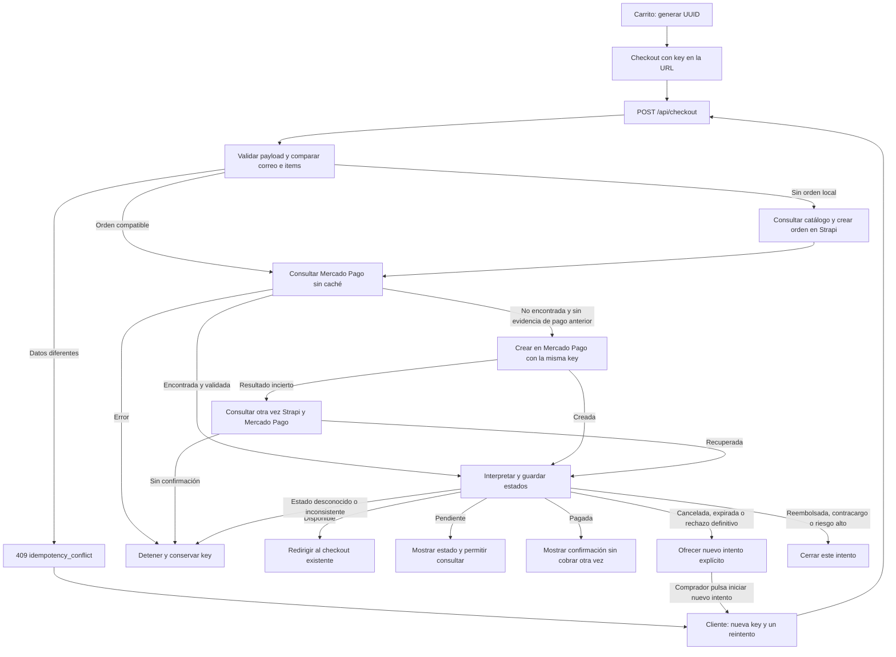

# Flujo de checkout

Este documento describe el flujo implementado actualmente y los motivos de sus decisiones. El checkout crea o recupera la orden de Mercado Pago, guarda sus estados y comprueba si el intento sigue disponible para pagar. También puede informar que el pago está pendiente, confirmado o cerrado. El endpoint de recepción de notificaciones ya valida la firma y la estructura mínima, pero la consulta canónica, la persistencia y la entrega todavía están pendientes.

## Archivos principales

| Archivo | Responsabilidad |
| --- | --- |
| [carrito/page.tsx](../app/(site)/carrito/page.tsx) y [cart-page.tsx](../app/components/cart-page.tsx) | Mostrar el carrito y generar la clave del intento al navegar al checkout. |
| [checkout/page.tsx](../app/(site)/checkout/page.tsx) y [checkout-page.tsx](../app/components/checkout-page.tsx) | Leer la clave de la URL, recoger el correo y mostrar el resumen. |
| [payment-button.tsx](../app/(site)/checkout/payment-button.tsx) | Enviar la solicitud, manejar errores y redirigir al proveedor. |
| [api/checkout/route.ts](../app/api/checkout/route.ts) | Coordinar la búsqueda, creación y recuperación de la orden. |
| [utils.ts](../app/lib/utils.ts) | Validar el payload y convertir errores de la orden en respuestas HTTP. |
| [get-or-create-order.ts](../app/lib/get-or-create-order.ts) | Buscar un intento existente y crear la orden local con sus productos e importes. |
| [get-items-for-order.ts](../app/lib/get-items-for-order.ts) | Consultar y comprobar los productos del catálogo por lotes. |
| [money.ts](../app/lib/money.ts) | Convertir soles a céntimos y formatear céntimos para Mercado Pago. |
| [mercado-pago.ts](../app/lib/mercado-pago.ts) | Crear y recuperar órdenes del proveedor. |
| [api/checkout/validate/route.ts](../app/api/checkout/validate/route.ts) | Recibir notificaciones de Mercado Pago, validar sus metadatos y firma y confirmar la estructura mínima del evento. |
| [order-state.ts](../app/lib/order-state.ts) | Interpretar los estados y decidir si se puede pagar, consultar o iniciar otro intento. |
| [update-order.ts](../app/lib/update-order.ts) | Guardar el ID, URL, estados originales y estados de negocio en Strapi. |
| [strapi.ts](../app/lib/strapi.ts) | Hacer las solicitudes autenticadas a Strapi y manejar sus errores. |
| [schema de order](../../api/src/api/order/content-types/order/schema.json) y [componente order-items](../../api/src/components/shared/order-items.json) | Definir la orden y la copia de los artículos comprados. |

## Recorrido general



La clave se genera al pulsar «IR A PAGAR». Visitar `/checkout?key=...` todavía no crea una orden: la creación comienza al pulsar «CONTINUAR AL PAGO».

## 1. La clave identifica un intento de compra

El carrito genera `crypto.randomUUID()` y navega a `/checkout?key=<uuid>`. El botón de pago usa la clave de la URL actual y la envía como `key` a nuestro servidor. El servidor la guarda como `idempotencyKey` y la utiliza en el header `X-Idempotency-Key` al crear la orden en Mercado Pago.

El objetivo es que un reintento del mismo proceso reutilice la orden local y el enlace del proveedor. Esto ayuda ante un doble clic, solicitudes concurrentes o una respuesta perdida. El botón también bloquea envíos mientras hay una solicitud en curso, pero la protección del cliente por sí sola no resuelve la concurrencia en el servidor.

Volver desde Mercado Pago a la misma URL del checkout permite reutilizar el intento si el correo y los artículos enviados coinciden. La clave no restaura el correo del formulario: actualmente ese campo vive en el estado del componente. Volver al carrito y pulsar otra vez «IR A PAGAR» genera una nueva clave.

### Qué se compara al reutilizar una orden

`getOrderByIdempotencyKey(key, email, items)` busca la clave y comprueba:

- El correo, después de aplicar `trim()` y `toLowerCase()`.
- Los IDs de los productos y sus cantidades, independientemente del orden del array.
- Que no haya IDs repetidos ni diferencias en el número de artículos.

Si no existe la orden, devuelve `[null, null]`. Si existe y coincide, devuelve `[null, order]`, aunque todavía no tenga `checkoutUrl`. Esa orden incompleta permite continuar el mismo intento.

Si el correo, los productos o sus cantidades cambiaron, devuelve `IdempotencyConflictError`, que la ruta transforma en `409 idempotency_conflict`. No devuelve `null`: eso permitiría intentar crear otra compra con una clave que ya pertenece a datos distintos.

El cliente responde al conflicto generando otra clave, reemplazándola en la URL mediante `history.replaceState` y haciendo un único reintento. Los errores de red o resultados inciertos no provocan este cambio de clave.

### Por qué la búsqueda tiene `pageSize: 2`

Se espera encontrar cero o una orden. Pedir hasta dos permite detectar si hay varias órdenes con la misma clave y detener el flujo en lugar de elegir una arbitrariamente. No es un recorrido de todas las páginas.

La prevención de duplicados depende de la restricción única: el schema declara `idempotencyKey` con `unique: true`. La base de datos debe mantener una restricción única efectiva para este campo. La búsqueda inicial no basta, porque dos solicitudes podrían consultar al mismo tiempo y ambas ver que todavía no existe una orden.

### Recuperación cuando falla la escritura en Strapi

Después de un error al crear la orden local, `createOrder` vuelve a buscar por la misma clave. Hay dos situaciones que explican esta decisión:

1. Otra solicitud creó la orden mientras esta solicitud intentaba guardarla.
2. Strapi guardó la orden, pero se perdió la respuesta de la escritura.

Si la búsqueda encuentra una orden compatible, se devuelve esa orden. Si encuentra un conflicto de datos, se devuelve el conflicto. Si no logra recuperar una orden compatible, se conserva el error original de creación.

Un error de la solicitud no demuestra que la escritura haya fallado.

## 2. Los datos del catálogo se consultan en el servidor

El cliente envía la clave, el correo y artículos con ID, cantidad y portada. El servidor no toma precios, nombres ni totales del carrito como autoridad para cobrar. Consulta los productos en Strapi y crea una copia de sus datos dentro de la orden.

La portada enviada por el cliente tampoco determina la portada guardada: se usa la del producto en producción y una imagen de ejemplo en desarrollo.

### Por qué consultamos los productos por lotes

La [configuración REST actual de Strapi](../../api/config/api.ts) establece `defaultLimit: 25` y `maxLimit: 100`. Un filtro por muchos IDs no elimina la paginación: una consulta sin un tamaño explícito puede devolver solo parte de los productos solicitados.

`getItemsForOrder` divide los IDs únicos en lotes de hasta 25 y consulta cada lote con filtros indexados:

```text
filters[id][$in][0]=101
filters[id][$in][1]=102
pagination[page]=1
pagination[pageSize]=2
```

El tamaño de página es el número de IDs del lote. Los lotes se consultan secuencialmente y sus resultados se acumulan. Cada consulta usa la página 1 porque cambia el filtro de IDs; no se está recorriendo el catálogo completo página por página.

```ts
for (let offset = 0; offset < ids.length; offset += PRODUCT_BATCH_SIZE) {
  const batchIds = ids.slice(offset, offset + PRODUCT_BATCH_SIZE);
  // Consultar y validar este grupo de IDs.
}
```

Con 60 productos distintos, se hacen tres consultas: 25, 25 y 10. Esto mantiene cada consulta dentro del tamaño elegido y evita depender del límite por defecto de Strapi.

Después de cada consulta se comprueban la cantidad de resultados y todos los IDs esperados. Si falta un producto, se rechaza la creación en lugar de generar una orden parcial. Esta comprobación confirma que los productos se recuperaron; todavía no verifica stock suficiente ni reserva inventario.

## 3. El dinero se calcula y guarda en céntimos

| Lugar | Representación | Ejemplo |
| --- | --- | --- |
| Precio del producto en Strapi | Decimal en soles | `19.90` |
| Carrito y resumen del cliente | Soles | `S/ 19.90` |
| Importes de la orden y sus artículos | Enteros en céntimos | `1990` |
| Payload enviado a Mercado Pago | String decimal en soles | `"19.90"` |

El editor del catálogo continúa introduciendo precios en soles. La conversión ocurre en el servidor al crear la orden. Los campos monetarios de la entidad `order` y del componente `order-items` sí guardan céntimos: son el registro de la compra, separado del precio editable del catálogo.

`solesToCents` interpreta los dígitos decimales mediante `BigInt` y devuelve un entero seguro. Así evitamos basar el cálculo en `price * 100`, que puede introducir errores de coma flotante. Se rechazan importes negativos, formatos inválidos, fracciones con valor más allá de dos decimales e importes fuera del rango seguro. Los ceros adicionales, como `19.900`, no cambian el importe y se aceptan.

Cada línea calcula `totalPrice = unitPrice * quantity`; se valida que el resultado y el subtotal sean enteros seguros. Actualmente el descuento es cero, la moneda de las nuevas órdenes es `PEN` y el total es igual al subtotal.

Los campos `biginteger` de Strapi se leen como strings. `centsToSoles` los formatea con dos decimales al preparar el payload para Mercado Pago.

### Por qué conservamos los precios de la orden

Una orden guarda una copia de los datos e importes utilizados al iniciar ese intento. Al reintentar la misma clave, Mercado Pago recibe la referencia, los artículos y los precios de esa orden, sin recalcularlos con el catálogo actual.

Esto mantiene consistente el intento aunque después se edite el producto. Para una orden nueva se consulta nuevamente el catálogo. Mostrar al comprador una diferencia entre el precio de su carrito local y el precio vigente del servidor sigue pendiente.

## 4. Identificadores de Strapi y Mercado Pago

| Campo | Significado y uso |
| --- | --- |
| `documentId` | Identificador de la orden en Strapi. Se usa al actualizar `orders/{documentId}`. |
| `orderNumber` | UUID generado en el servidor para la orden local. Se envía como `external_reference` a Mercado Pago. |
| `idempotencyKey` | Clave del intento enviada por el cliente. Se reutiliza en `X-Idempotency-Key`. |
| `providerOrderId` | ID real devuelto por Mercado Pago. Permite consultar directamente la orden del proveedor. |
| `checkoutUrl` | Enlace de Mercado Pago guardado para redirigir al comprador y reutilizarlo. |

`providerOrderId` debe guardar `checkout.id`, no el `documentId` de Strapi. `external_reference` permite relacionar ambas órdenes incluso si no se alcanzó a guardar el ID del proveedor.

La creación utiliza `POST /v1/orders` con `type: 'online'`, `processing_mode: 'manual'`, los importes formateados y `external_reference: order.orderNumber`. Configura `auto_return: 'approved'` y una `success_url` hacia `/checkout/success`. No envía `config.online.retries`, porque no tenemos confirmado su soporte como parámetro de creación de Checkout Pro. El flujo lee `config.online.retries.allowed` de la respuesta del proveedor: si permite reintentos, se puede reutilizar el mismo enlace ante rechazos reconocidos; si los deshabilita, se ofrece un nuevo intento explícito; si no conocemos esa configuración, conservamos la clave y no creamos otra orden automáticamente.

En el payload actual, `createMercadoPagoOrder` envía un correo fijo de prueba en `payer.email` y deja comentado el uso de `order.email`. Por eso el correo de la orden todavía no se transmite al proveedor fuera de pruebas; debe corregirse antes de producción.

## Recepción de notificaciones

`POST /api/checkout/validate` se ejecuta con `runtime = 'nodejs'` porque usa `WebhookSignatureValidator` del SDK `mercadopago` 3.6.1 y la criptografía de Node. En esta etapa solo confirma la recepción autenticada de la notificación.

La recepción exige los headers `x-signature` y `x-request-id`, además de exactamente un parámetro de query `data.id`. El SDK recibe ese ID normalizado con `trim().toLowerCase()` al validar la firma. Después se parsea JSON y se exige un objeto con `type` string y `data` objeto. `body.data.id` debe ser un string; sus extremos se recortan y se normaliza a minúsculas antes de compararlo con el único `data.id` de la query. Así, el mismo ID con diferencias de espacios o mayúsculas se reconoce como igual, mientras que un ID distinto se rechaza.

El cuerpo mínimo esperado es:

```json
{
  "type": "order",
  "data": { "id": "<id-de-la-orden>" }
}
```

El cuerpo JSON y sus campos financieros no son una fuente confiable para aprobar el pago: la firma vincula el ID de la query, no el JSON completo ni su importe o estado. El ejemplo recibido con `data.type: "point"` corresponde a una orden Point, distinta del tipo online de este checkout; al ser un ejemplo o simulación, no demuestra un pago de nuestra compra. Los tópicos autenticados distintos de `order` se aceptan en esta fase y reciben cuerpo vacío con `200`.

Las respuestas del endpoint tienen cuerpo vacío:

| Respuesta | Situación |
| --- | --- |
| `200` | Recepción validada, tanto para una notificación `order` como para otro tópico autenticado. Este `200` es solo un ACK de recepción: no confirma el pago ni garantiza que el evento se haya procesado. |
| `401` | Faltan `x-signature`, `x-request-id` o el único `data.id`, hay metadatos duplicados o la firma no es válida. |
| `400` | JSON inválido, estructura mínima ausente o `body.data.id` diferente del `data.id` firmado en la query después de normalizar extremos y mayúsculas. |
| `503` | Falta `WEBHOOK_MERCADOPAGO`. |
| `500` | Error inesperado durante la recepción. |

Los logs solo registran razones controladas, como `missing_secret`, el motivo de rechazo que proporciona el SDK o `unexpected_error`. No registran el cuerpo, el secreto ni la firma.

Este endpoint todavía no consulta `GET /v1/orders/{id}` en Mercado Pago, no escribe en Strapi, no usa una cola durable y no deduplica ni entrega compras. Tampoco se activa `toleranceSeconds`, por lo que esta implementación no documenta una ventana anti-replay. El manejo de eventos repetidos y concurrentes sigue pendiente. Para no perder notificaciones, la siguiente etapa debe persistir y encolar antes del ACK, o completar la reconciliación antes de responder `200`.

La referencia oficial consultada describe la validación de firma del SDK, la consulta posterior de la orden y los ACK `200/201` con reintentos: [notificaciones de Checkout Pro Orders de Mercado Pago](https://www.mercadopago.com.pe/developers/es/docs/checkout-pro-orders/notifications?scope=prod).

## 5. Recuperar antes de crear otro checkout

Strapi y Mercado Pago son dos sistemas separados. Puede quedar una orden local sin URL aunque Mercado Pago ya haya creado su orden: por ejemplo, si se pierde la respuesta del proveedor o falla la actualización posterior en Strapi.

Por eso la ruta siempre ejecuta `recoverMercadoPagoOrder`, incluso si ya tiene `checkoutUrl`. Un enlace guardado no demuestra que el intento siga disponible: podría haberse pagado, cancelado o expirado. Si la búsqueda no encuentra una orden pero Strapi conserva evidencia de un pago anterior, el flujo se detiene y conserva la clave.

### Cómo funciona `recoverMercadoPagoOrder`

1. Si ya existe `providerOrderId`, consulta directamente `GET /v1/orders/{id}`.
2. Si no existe, busca por `external_reference: order.orderNumber`, desde cinco minutos antes de la fecha de creación local hasta el momento actual. Ese margen permite una pequeña diferencia de reloj entre sistemas.
3. La búsqueda pide hasta dos resultados y comprueba también el total informado. Si hay varias coincidencias, devuelve un error; si no encuentra ninguna, devuelve `[null, null]`.
4. Consulta el detalle de la orden encontrada y valida ID, referencia externa, importe, moneda, tipo `online` y modo `manual` contra la orden local.
5. Conserva `status`, `status_detail` y la configuración de reintentos del detalle. Usa `checkout_url` si viene; si falta y el estado puede admitir un pago, construye el enlace de Checkout Pro de Perú con `order_id`, únicamente cuando el país sea `PE` o `PER` y la moneda sea `PEN`. Una orden pagada o cerrada no necesita URL para reconciliar su estado.

El resultado distingue tres situaciones:

| Resultado | Qué significa |
| --- | --- |
| `[null, checkout]` | Se encontró y validó una orden del proveedor. |
| `[null, null]` | La búsqueda no encontró una orden. |
| `[error, null]` | No se pudo comprobar o validar la orden. |

En la recuperación inicial, un error detiene el flujo con `502 checkout_recovery_error`. No se trata una consulta fallida como evidencia de que no existe una orden.

### Qué hace `saveCheckoutResponse`

Comprueba que haya ID y estado, y utiliza `getOrderStateDecision` para interpretar la respuesta. Mercado Pago puede omitir `status_detail` en una orden `created`, tanto al crearla como al consultar su detalle: esa combinación representa una orden pendiente y permite redirigir. No inventamos un detalle; guardamos `providerStatusDetail: null` cuando falta. Para estados que requieren un detalle reconocido, su ausencia mantiene la decisión como desconocida. Guarda en Strapi `providerOrderId`, `providerStatus`, `providerStatusDetail`, la URL cuando existe y los estados de negocio reconocidos. Solo exige y devuelve URL cuando la decisión es `redirect`. Si la escritura falla, no entrega una respuesta de éxito.

Se utiliza después de una creación correcta y después de una recuperación. Centraliza la misma operación de persistencia en ambos casos. La creación por sí sola no confirma un pago: se exige la combinación `processed` / `accredited` para marcarlo como aprobado. Esta función no entrega archivos ni envía correos.

### Por qué la recuperación se repite después de ciertos errores

Si la creación devuelve `idempotency_key_already_used`, `resource_locked`, `network_error` o un HTTP de la familia `5xx`, el resultado puede ser incierto. La solicitud pudo ser aceptada aunque no recibamos una respuesta correcta, o una solicitud concurrente pudo terminar mientras tanto.

La ruta vuelve a consultar Strapi y después Mercado Pago, aunque la nueva lectura local ya tenga URL. El estado de ambos sistemas puede haber cambiado desde la recuperación inicial y no se reutiliza una URL sin comprobar el proveedor.

Si no logra recuperar el enlace, responde `503 checkout_pending` con `Retry-After: 3`. El cliente muestra el mensaje y conserva la clave; actualmente el usuario debe volver a pulsar el botón, porque no hay reintento automático por ese header.

Conservar la clave evita iniciar otro intento cuando el primero podría existir pero todavía no ser visible. Estas comprobaciones reducen el riesgo de duplicación; no convierten las operaciones entre ambos sistemas en una transacción atómica.

### Estados originales, estados de negocio y reutilización

Los campos `providerStatus` y `providerStatusDetail` son strings opcionales y sin valor predeterminado. Guardan los valores originales del proveedor, incluidos valores nuevos que aún no conocemos. Las decisiones de negocio siguen centralizadas en `order-state.ts`; un estado no reconocido se registra pero no autoriza un cobro ni altera los estados de negocio.

| Estado / detalle del proveedor | `paymentStatus` | Decisión del checkout |
| --- | --- | --- |
| `created` / `created` o detalle ausente | `PENDING` | Reutilizar el enlace. |
| `processed` / `accredited` | `APPROVED` | Mostrar pago confirmado. |
| `processed` / `partially_refunded` | `PARTIALLY_REFUNDED` | Mostrar compra pagada con reembolso parcial; no cobrar otra vez. |
| `processed` o `refunded` / `refunded` | `REFUNDED` | Cerrar el intento. |
| `charged_back` / detalle reconocido | `CHARGED_BACK` | Cerrar el intento. |
| `processing` / detalle reconocido | `IN_PROCESS` | Mostrar pago pendiente y permitir consultar con la misma clave. |
| `action_required` / `waiting_payment` o `waiting_transfer` | `PENDING` | Indicar que se completen las instrucciones del proveedor. |
| `action_required` / `waiting_capture` o `waiting_retry` | `IN_PROCESS` | Mantener pendiente, sin iniciar otro cobro. |
| `canceled` / `canceled`, o `expired` / detalle reconocido | `CANCELLED` | Ofrecer un nuevo intento explícito. |
| `failed` / rechazo reconocido, con reintentos deshabilitados | `REJECTED` | Ofrecer un nuevo intento explícito. |
| `failed` / rechazo reconocido, con reintentos habilitados | `REJECTED` | Reutilizar el checkout, salvo límite de intentos alcanzado. |
| `failed` / `high_risk` | `REJECTED` | Cerrar el intento y pedir revisión de la compra. |
| Combinación desconocida o incompatible con una compra ya pagada | Sin cambio | `503 checkout_status_unknown`; conservar la clave. |

Un pago aprobado cambia `orderStatus` a `CONFIRMED`, nunca a `COMPLETED`: este último estado corresponde a la entrega. Los intentos pendientes mantienen `PENDING_PAYMENT`; los cerrados pasan a `CANCELLED`. Una compra ya `COMPLETED` conserva ese estado aunque después tenga un reembolso o contracargo, para preservar el historial de entrega; `paymentStatus` registra el cambio financiero.

La función impide volver de un estado financiero aprobado, reembolsado o disputado a uno pendiente o rechazado usando la orden local recibida. Tampoco reabre un intento local cancelado como pendiente o disponible para pagar. Esto no sustituye el control de concurrencia de las escrituras: las consultas y actualizaciones entre ambos servicios no son una transacción atómica. El webhook deberá contemplar eventos repetidos y respuestas desactualizadas.

El cliente recibe `{ action, orderNumber, message }`, más `url` únicamente para `redirect`. Para `pending` muestra «CONSULTAR ESTADO» y mantiene la clave. Para `paid` muestra «PAGO CONFIRMADO» y deshabilita el pago. Para `new_attempt` muestra «INICIAR NUEVO INTENTO»: la clave cambia solo cuando el comprador vuelve a pulsar ese botón. Para `blocked` muestra el motivo y cierra el intento. Si cambian el correo o los artículos, la interfaz deja de mostrar el resultado correspondiente a los datos anteriores.

## 6. Consultas sin caché

La búsqueda de órdenes locales usa `cache: 'no-store'`. El helper de Mercado Pago también lo aplica a sus solicitudes. Queremos consultar los sistemas actuales al recuperar un intento: reutilizar una respuesta anterior que decía «no existe» impediría ver una orden creada por otra solicitud.

Esta decisión depende de la tolerancia a datos antiguos, no de si la URL es interna o externa. Los datos que determinan un cobro o la recuperación de un intento requieren información actual. Una vista del catálogo puede tener otra política si el negocio acepta cierto retraso en sus cambios.

En el contexto actual del handler `POST` y Next.js 16.3.4, estas consultas ya se realizan sin caché por defecto; `no-store` deja explícita la intención. No significa que Next.js almacene todas las peticiones por defecto ni impide guardar la orden en la base de datos.

La consulta de productos en `getItemsForOrder` todavía no declara `no-store` explícitamente y usa el comportamiento por defecto de este flujo. Las solicitudes a Mercado Pago tienen además un timeout de 15 segundos; el helper de Strapi todavía no define uno.

## 7. Validación y respuestas

En el cliente, el checkout comprueba que el correo no esté vacío, tenga un formato como `tu@correo.com` y pase la comprobación de formato del input nativo `type="email"`. Se eliminan los espacios de los extremos. Esta validación no demuestra que el buzón exista; el servidor sigue validando el payload de forma independiente.

Los errores de correo o términos se muestran junto al campo y mediante `react-hot-toast`. El `SiteToaster` compartido del layout del sitio usa los colores y la tipografía de la web; los errores se cierran automáticamente tras ocho segundos o con su botón de cierre. Se usa un ID fijo para el error del checkout, para evitar acumular notificaciones repetidas, y se elimina al iniciar otro envío o salir de la página. El foco se mueve al campo que necesita corregirse, y el formulario permite continuar con Enter. Los errores devueltos por la API y los de conexión también se muestran en ese toast, sin usar `alert()`.

Mientras se prepara el enlace, el botón muestra un spinner y el texto «CONSULTANDO PAGO…», queda deshabilitado y anuncia el progreso a lectores de pantalla. Se mantiene el bloqueo de solicitudes repetidas y la lógica de reintento con la misma clave; un conflicto de datos genera otra clave automáticamente; una orden cerrada que admite otra compra requiere pulsar explícitamente «INICIAR NUEVO INTENTO».

Antes de consultar o crear órdenes, el servidor valida JSON, una clave de 1 a 128 caracteres alfanuméricos, guion o guion bajo, un formato básico de correo y un array de artículos no vacío. Los IDs y cantidades deben ser enteros positivos seguros y no puede haber IDs duplicados.

La aceptación de términos se comprueba actualmente en el cliente; no se envía ni se registra en la orden. Tampoco se han definido límites de negocio para el número de artículos o las cantidades máximas.

| Respuesta | Situación |
| --- | --- |
| `200` con `{ action, orderNumber, message, url? }` | Estado consultado y persistido; URL solo cuando se permite pagar. |
| `400 invalid_request` | Payload inválido o error de validación de Strapi mapeado a esta respuesta. |
| `409 idempotency_conflict` | La clave existente pertenece a otro correo o a otros artículos/cantidades. |
| `502 checkout_recovery_error` | Falló la recuperación inicial del proveedor. |
| `502 payment_provider_error` | Error de creación no tratado como incierto, o respuesta sin ID/URL válidos. |
| `503 checkout_status_unknown` | Estado no reconocido o incompatible con los estados guardados; conservar la clave. |
| `503 checkout_pending` | Resultado incierto sin enlace recuperable todavía; conservar la clave. |
| `404 not_found` / `502 upstream_error` | Errores de Strapi según el mapeo del helper. |
| `500 order_error` | Otros errores locales al buscar o crear la orden. |

## 8. Checklist de tareas pendientes

La checklist general de estados, webhook, resultado, entrega, correo, productos, carrito y preparación para producción está en [todos.md](todos.md). El documento conserva aquí el contexto conceptual del flujo implementado.
